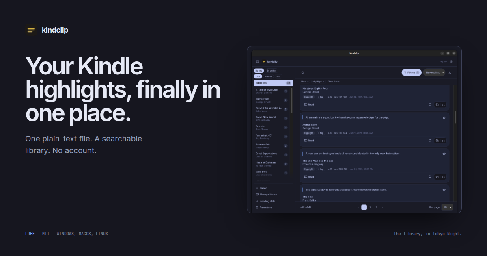
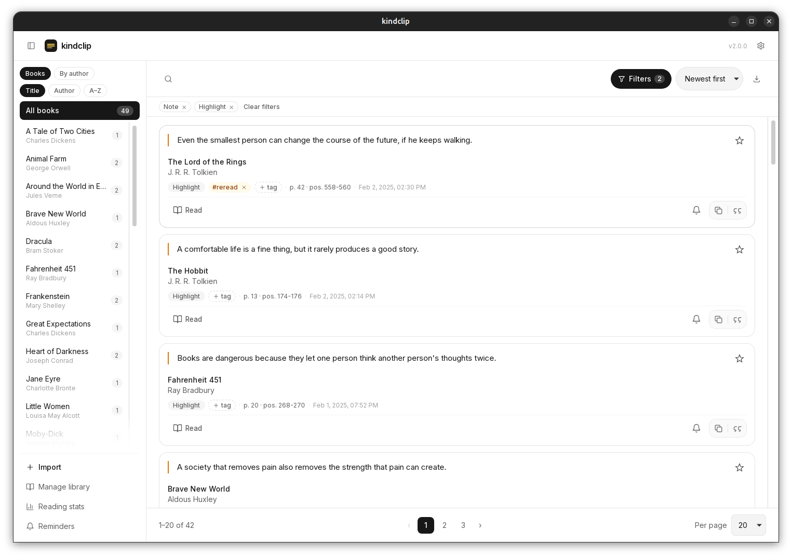
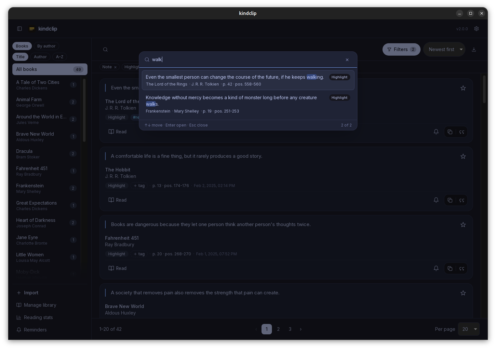

#  kindclip

Desktop viewer for your Kindle highlights. Import `My Clippings.txt`, search and
filter across text, books and authors, star favorites, tag, edit notes, schedule
reminders, export to Markdown, JSON or CSV, and track your reading stats.
Native look, tiny binaries, local-only, on Windows, Linux and macOS.

**[https://damrek.github.io/kindclip/](https://damrek.github.io/kindclip/)** ·
screenshots, palettes and downloads.


<p>
  
</p>

<details>
<summary>More screenshots</summary>

<p align="center">
  
  
</p>
<p align="center">
  
  
</p>

</details>

## Usage

1. Install from [Releases](https://github.com/damrek/kindclip/releases/latest):
   `.AppImage`/`.deb`/`.rpm` (Linux), `.exe` (Windows), `.dmg` (macOS). Changes
   per version live in [CHANGELOG.md](CHANGELOG.md).
2. Copy `documents/My Clippings.txt` from your Kindle.
3. **Import** → pick the file, or drag a `.txt` onto the window. Re-import any
   time: duplicates are skipped by content hash and new highlights are added.
4. Search and filter (`?` lists every shortcut), open a clipping with **Read**,
   export the current view, or back up from **Preferences → Data**.

## Features

### Import & read
- **Parser** for UTF-8/16 (BOM or mid-file) and six date locales, with
  highlight, note and bookmark kinds, including modern Spanish firmware
  («Tu resaltado»). Multi-file libraries dedupe by content hash.
- **Drag & drop** anywhere on the window runs the same parse, dedupe and
  progress report as the Import button.
- **Reading view** opens any clipping full-window, moves through the filtered
  list with ←/→, and Esc returns you to your place.
- **Note editing** rewrites a note inline with an **Edited** badge, resets it to
  the original, and filters edited notes. `My Clippings.txt` is never modified.

### Organize & find
- **Favorites** live in SQLite; any highlight or note copies as a Markdown
  blockquote citing author, book and page (or position).
- **Tags** are free-form per clipping, added inline with suggestions and
  clickable to filter (AND logic). Rename, merge or delete them in
  **Library → Tags**; orphan tags stay listed for cleanup.
- **Library management** filters books by title or author, renames or merges
  books, deletes a book with its clippings and undoes one import. Destructive
  actions confirm; re-importing restores clippings but not favorites, tags or
  edited notes.
- **Search** covers content, title and author, ignoring accents and case, with
  every word required and every hit highlighted. Combine it with book,
  author, type, status and tag filters; chips remove them one by one, sorting
  persists, and pages hold 20, 50 or 100 rows.
- **Reading stats** (sidebar footer) show library totals, clippings per year,
  an interactive kind donut (hover for counts and shares, click to filter) and
  the top books, grouping undated clippings as “no date”.
- **Reminders** schedule a system notification from any card's bell — tonight,
  tomorrow, in a week or an exact time. Delivery happens while the app runs and
  catches up on launch; the sidebar lists, edits and removes them, asking for
  confirmation before deleting.

### Export & data
- **Export** the filtered view to Markdown, JSON or CSV grouped by book, with
  favorites and tags marked. Markdown can also write one file per book into a
  folder, with Obsidian-ready frontmatter. Labels follow the app language;
  JSON/CSV fields stay in English for scripting.
- **Backup & restore** (Preferences → Data) saves a consistent `kindclip.db`
  snapshot. A restore verifies the file is real SQLite with the kindclip tables
  and no failed migrations, previews it, and keeps the replaced database as
  `kindclip.db.before-restore`; older snapshots migrate on launch, newer ones
  are refused.
- **Daily snapshots** land in `backups/` next to the database, keeping the
  newest seven; a manual backup saved there counts for the day. **Open database
  location** reveals the file in your file manager.

### Look, keys and language
- **Seven dark palettes** plus light, **five text sizes** (XS–XL) and three list
  densities (compact, comfortable, spacious). Body, muted, accent and status
  text clear 4.5:1 on every surface they land on, in all eight palettes.
- **Keyboard-first**: `?` lists the shortcuts; `/`, `Ctrl/Cmd+K` and
  `Ctrl/Cmd+F` focus search; `Ctrl/Cmd+P` searches every clipping; `j`/`k` or
  ↑/↓ select, `Enter`/`o` reads, `*` favorites, `c` copies, `q` quotes,
  `s`/`f` toggle sidebar and filters, `n`/`p` page, `Ctrl/Cmd+,` opens
  preferences. Esc closes one layer at a time.
- **5 languages** (es/en/fr/de/it, Spanish default), the bundled **Inter** font,
  custom icons and a minimal macOS-style shell over the native frame, with the
  window size, position and state remembered.
- **Diagnostic logs** rotate locally and record paths, counts, sizes and errors
  only — never clipping text, notes or queries. Nothing is uploaded.

## Development

**Requirements**: Node.js 22.22+, 24.15+ or 26+, and a stable Rust toolchain.

```bash
# Linux build deps (Ubuntu)
sudo apt update && sudo apt install -y libwebkit2gtk-4.1-dev build-essential \
  curl wget file libxdo-dev libssl-dev libayatana-appindicator3-dev \
  librsvg2-dev patchelf

npm install
npx tauri dev                    # not `npm run dev`: no Tauri IPC bridge
npx tauri build                  # bundles land in target/release/bundle

npm test                         # vitest (frontend)
npm run check                    # svelte-check
npm run lint                     # eslint (flat config)
npm run build                    # vite build
cargo test --workspace
cargo clippy --workspace --all-targets
cargo fmt --all -- --check
```

Component tests mount Svelte in jsdom: a file opts in with
`// @vitest-environment jsdom` and reuses `src/test/component.ts`. Every other
suite keeps the fast node environment.

CI (`.github/workflows/ci.yml`) runs the checks on every pull request and on
every commit that lands on `main`; all three matrix jobs are required. The
Ubuntu leg also covers the release-notes script. Releases
(`.github/workflows/release.yml`) run from `workflow_dispatch` or a `v*` tag,
refuse a commit outside `main` or version files that disagree, build the
platforms, and publish the `CHANGELOG.md` section as the release body.
Windows ships the NSIS `.exe` only; macOS/Windows artifacts are unsigned, so
Gatekeeper and SmartScreen will warn.

## Structure

```
src/                        # Svelte 5 + Tailwind v4 frontend
  App.svelte                # shell: layout, dialogs and list orchestration
  lib/                      # domain modules (filters, sorting, library, reading, reminders, …)
    db/                     # data layer split by entity (clippings, books, tags, files, reminders, settings)
  components/               # BookSidebar, ClippingCard, dialogs, …
src-tauri/
  src/                      # plugin/command registration, file I/O
  migrations/               # 001 init … 006 reminders
  capabilities/             # least privilege: sql, dialog, clipboard, opener, log, notification, updater, process
crates/clippings-parser/    # pure My Clippings.txt parser (no Tauri deps)
```

## Database Location

Resolved to the standard per-OS config dir (`identifier: app.kindclip`):

| OS | Path |
|---|---|
| Linux | `~/.config/app.kindclip/kindclip.db` |
| Windows | `%APPDATA%\app.kindclip\kindclip.db` |
| macOS | `~/Library/Application Support/app.kindclip/kindclip.db` |

Delete the file to wipe the library and note edits, then re-import. A restore
keeps the replaced file as `kindclip.db.before-restore`; daily snapshots live in
`backups/` next to the database, pruned to the newest seven. Logs live under the
per-OS log dir (`~/.local/share/app.kindclip/logs` on Linux,
`%LOCALAPPDATA%\app.kindclip\logs` on Windows,
`~/Library/Logs/app.kindclip` on macOS), rotated at 1 MB over three files and
opened from **Preferences → Diagnostics**.

## Updates

kindclip checks for a new release when it starts, and again whenever you click
the version in the header. A dot on that button means a release is waiting;
clicking it shows what changed in the new version and offers to install it.
Updates are signed, verified against the public key embedded in the app, and
followed by a restart. Nothing is downloaded unless the version is newer and
its signature matches.

On Linux only the **AppImage** can update itself: a `.deb` or `.rpm` install
must download the next release by hand. Windows (NSIS) and macOS (universal)
update in place.

Releases are signed with a minisign key. The public half lives in
`src-tauri/tauri.conf.json`; the private half is the
`TAURI_SIGNING_PRIVATE_KEY` repository secret (with
`TAURI_SIGNING_PRIVATE_KEY_PASSWORD` when it has one), so a local
`npm run tauri build` needs the same environment variable to bundle. Each
release also publishes one `latest.json` covering every platform, composed by
`.github/scripts/updater-manifest.sh` after the build matrix finishes.

## Roadmap

Planned, no dates attached:

- **Recall**: a random clipping from the current filters, plus “on this day”
  clippings from previous years.

## License

MIT — see [LICENSE](LICENSE).
