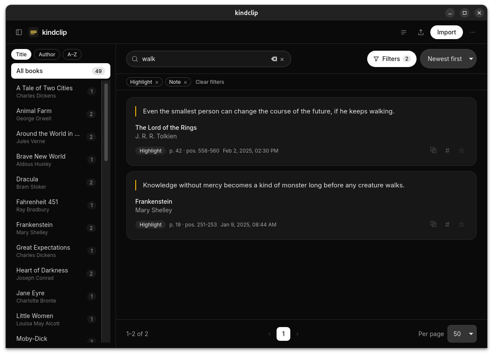

#  kindclip

Desktop viewer for your Kindle highlights. Import `My Clippings.txt`, search
by text, book or author, page through results, star favorites, tag clippings,
edit notes and export to Markdown, JSON or CSV. Native look, tiny binaries,
on Windows, Linux and macOS.


<p>
  
</p>
*Library view: collapsible book sidebar, collapsible search, one Filters menu
with active chips, and the ⋯ preferences menu — in dark theme.*

## Usage

1. Download an installer from [Releases](https://github.com/damrek/kindclip/releases/latest):
   `.AppImage`/`.deb`/`.rpm` (Linux), `.exe`/`.msi` (Windows), `.dmg` (macOS).
2. Plug in your Kindle, copy `documents/My Clippings.txt`.
3. **Import** → pick the file → browse. Re-import anytime: duplicates are
   detected by hash, failed parses auto-heal.
4. **Export** (header icon) → current filters to Markdown, JSON or CSV,
   grouped by book.
5. **Read** (⤢ on any card) → full-window reading view; ←/→ move through the
   whole filtered list, Esc closes and keeps your place.
6. **Manage library** (header icon) → rename/merge books, delete a book, or
   undo a single bad import without wiping the database.

## Features

### Core
- **Robust parser**: UTF-8/16 (BOM or mid-file), localized dates (en/es/de/fr/it/pt),
  Highlight/Note/Bookmark kinds — including modern Spanish firmware («Tu resaltado»).
- **Multi-file library** with content-hash deduplication across imports.
- **Reading view**: open any clipping full-window and move through the whole
  filtered list with ← / →; Esc closes and keeps your place.
- **Note editing**: inline rewrite with **Edited** badge, reset to original anytime,
  edited-notes filter. `My Clippings.txt` is never modified (one-way sync).

### Library & Organization
- **Favorites** in SQLite, copy button on every highlight/note.
- **Tags**: free-form per clipping, inline add/remove with suggestions.
  Click a tag to filter instantly (AND logic). Manage (rename/merge/delete) in
  Library dialog → Tags tab; orphan tags stay listed for cleanup, hidden from filter.
- **Library management**: filter books by title or author, rename/merge books,
  delete book + clippings, list imported files to undo one import. Destructive
  actions confirm; re-importing the same file restores its clippings, but
  favorites, tags and edited notes are not recoverable.

### Search & Filter
- **Unified Filters menu** (badged count, removable chips, Clear all): full-text
  search (content/title/author, accent- and case-insensitive), book,
  multi-select type/status/tag filters.
  Click a card's type badge or Edited badge to toggle that filter instantly,
  like tags. All combinable. Configurable pagination (20/50/100).
- **Sorting**: books by title/author (↑/↓); clippings by newest/oldest,
  book title (A–Z/Z–A), or page. All persisted.

### Export & Data
- **Export** filtered view to Markdown, JSON, CSV — one file grouped by book,
  favorites/tags marked, labels in app language; JSON/CSV use stable English
  fields (original + edited notes, tags) for scripting.
- **Open database location** (⋯ menu) reveals `kindclip.db` in file manager.

### UI & Accessibility
- **Collapsible shell**: sidebar toggle (remembered), search collapses to icon
  until clicked or has text.
- **Grouped header**: sidebar toggle, Import, Export, Manage library, ⋯ menu
  (Preferences: language, system/light/dark theme, text size S/M/L, DB location).
- **5 languages** (es/en/fr/de/it, Spanish default).
- Bundled **Inter** font, custom icons, minimal macOS-style UI over native frame.

## Development

**Requirements**: Node.js 20+, stable Rust toolchain.  
**Linux deps** (Ubuntu):
```bash
sudo apt update && sudo apt install -y libwebkit2gtk-4.1-dev build-essential \
  curl wget file libxdo-dev libssl-dev libayatana-appindicator3-dev \
  librsvg2-dev patchelf
```

```bash
npm install
npx tauri dev      # do NOT use plain `npm run dev`: no Tauri IPC bridge
npx tauri build    # .deb/.rpm/.AppImage on Linux — see target/release/bundle
```

**Tests & checks**:
```bash
npm test           # vitest (frontend)
npm run check      # svelte-check
npm run build      # vite build
cargo test --workspace
cargo clippy --workspace --all-targets
cargo fmt --all -- --check
```

Releases automated on `v*` tag push (`.github/workflows/release.yml`): syncs
version, checks, tests, attaches bundles for macOS (ARM+Intel), Linux, Windows.
*macOS/Windows artifacts unsigned — Gatekeeper/SmartScreen will warn.*

## Structure

```
src/                        # Svelte 5 + Tailwind v4 frontend
  lib/
    db.ts                   # SQL port (plugin-sql): queries + import orchestration
    exporter.ts             # Export serializers: Markdown/JSON/CSV
    importer.ts             # Import flow: pick → parse → persist
    i18n.ts                 # es/en/fr/de/it dictionaries
    theme.ts                # system/light/dark theme
    types.ts                # Shared frontend/backend contracts
    ... (font.ts, library.ts, sidebar.ts, db-location.ts)
  components/               # BookSidebar, ClippingCard, FilterMenu, ...
  assets/icon.png
src-tauri/
  src/
    lib.rs                  # Migrations + plugin/command registration
    commands.rs             # parse_clippings_file, db_file_path, write_export_file
  migrations/               # 001 init … 005 search folding
  capabilities/             # Least-privilege (sql, dialog, clipboard, opener)
crates/clippings-parser/    # Pure My Clippings.txt parser (no Tauri deps)
```

## Database Location

Resolved to standard per-OS config dir (`identifier: app.kindclip`):

| OS | Path |
|---|---|
| Linux | `~/.config/app.kindclip/kindclip.db` |
| Windows | `%APPDATA%\app.kindclip\kindclip.db` |
| macOS | `~/Library/Application Support/app.kindclip/kindclip.db` |

Delete the file to wipe library + note edits and re-import from scratch.  
Or use **Manage library** / **⋯ → Open database location** for granular actions.  
Quick count:
```bash
python3 -c "import sqlite3, os; con=sqlite3.connect(os.path.expanduser('~/.config/app.kindclip/kindclip.db')); print(con.execute('SELECT COUNT(*) FROM clippings').fetchone())"
```

## Roadmap

Planned, no dates attached:

- **Recall**: a random clipping from the current filters, plus "on this day"
  clippings from previous years.
- **Backup & restore**: export and import a snapshot of `kindclip.db` so tags,
  favorites and edited notes survive a reinstall.
- **Search upgrades**: multi-word queries and highlighted matches.
- **Keyboard-first**: shortcuts for search, dialogs and navigation.
- **Drag & drop import**: drop `My Clippings.txt` anywhere on the window.
- **Copy as quote**: Markdown citation with book, author and page.
- **Note ↔ highlight pairing**: show a note next to the highlight it belongs to.
- **Bulk actions**: tag, favorite or export a selection.
- **Reading stats**: clippings per year, book and kind.
- **Desktop polish**: auto-update, remembered window size and diagnostic logs.

The layered architecture (parser → commands → SQL → UI) keeps additions local.

## License

MIT — see [LICENSE](LICENSE).
