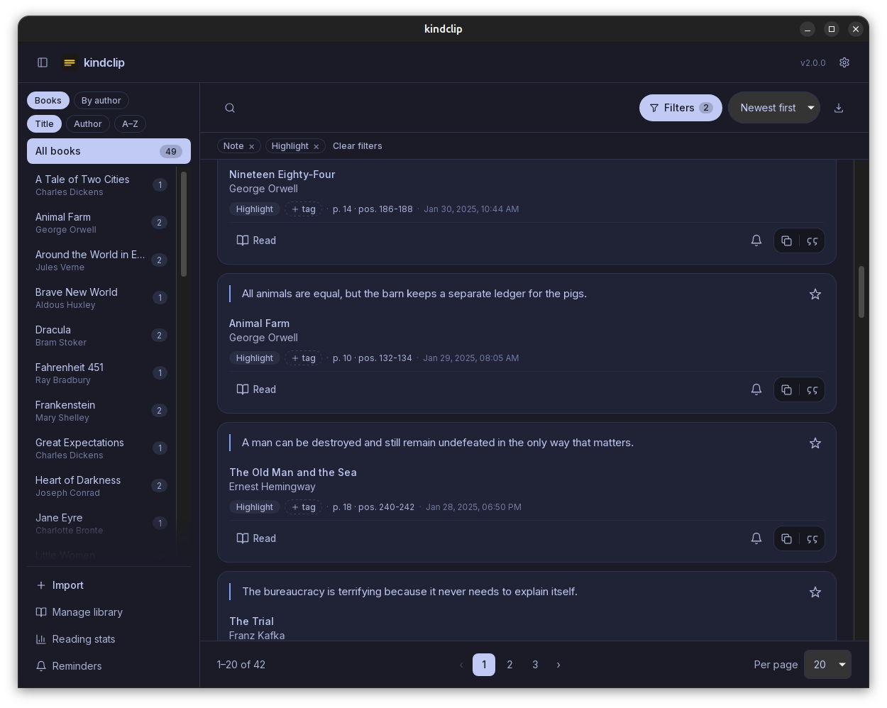
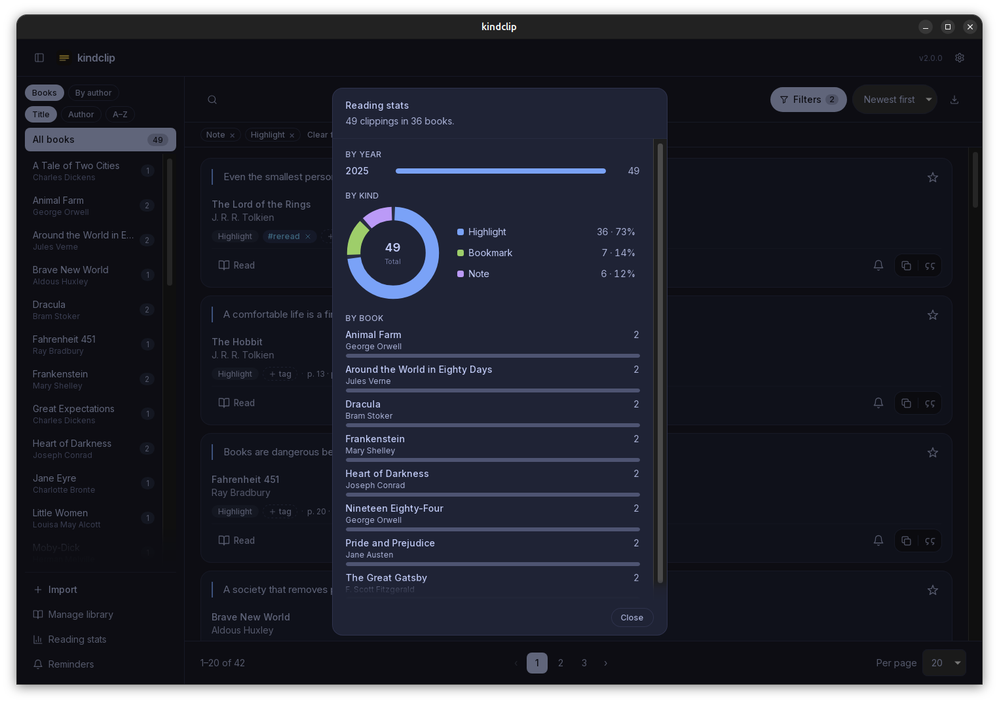

#  kindclip

Desktop viewer for your Kindle highlights. Import `My Clippings.txt`, search and
filter across text, books and authors, star favorites, tag, edit notes, schedule
reminders, export to Markdown, JSON or CSV, and track your reading stats.
Local-only, native, on Windows, Linux and macOS.

**[https://damrek.github.io/kindclip/](https://damrek.github.io/kindclip/)** ·
screenshots, palettes and downloads.


<p>
  
</p>

<details>
<summary>More screenshots</summary>

<p align="center">
  
  
</p>
<p align="center">
  
  
</p>

</details>

## Usage

1. Install from [Releases](https://github.com/damrek/kindclip/releases/latest):
   `.AppImage`/`.deb` (Linux), `.exe` (Windows), `.dmg` (macOS). Changes
   per version live in [CHANGELOG.md](CHANGELOG.md).
2. Copy `documents/My Clippings.txt` from your Kindle.
3. **Import** → pick the file, or drag a `.txt` onto the window. Re-import any
   time: duplicates are skipped by content hash and new highlights are added.
4. Search and filter (`?` lists every shortcut), read a clipping, export the
   current view, or back up from **Preferences → Data**.

## Features

- **Import**: UTF-8/16 files (BOM or mid-file), six date locales, highlight,
  note and bookmark kinds; drag & drop runs the same parse, dedupe and progress
  report.
- **Read**: a full-window reading view moves through the filtered list with
  ←/→, and Esc returns you to your place. Notes edit inline with an **Edited**
  badge, reset to the original and filter as edited; the Kindle file is never
  modified.
- **Organize**: favorites live in SQLite. Tags are free-form per clipping, added
  inline with suggestions and clickable to filter (AND), then renamed, merged or
  deleted from **Library → Tags**; orphan tags stay listed. Books filter by title
  or author, rename, merge or delete with their clippings, and one import can be
  undone. Destructive actions confirm.
- **Search**: content, title and author, accent- and case-insensitive, every word
  required and every hit highlighted. Combine with book, author, type, status and
  tag filters; chips remove them one by one, sorting persists, and pages hold 20,
  50 or 100 rows.
- **Stats**: library totals, clippings per year, an interactive kind donut (hover
  for counts and shares, click to filter) and the top books, with undated
  clippings grouped as “no date”.
- **Reminders**: a system notification per clipping — tonight, tomorrow, in a
  week or an exact time — delivered while the app runs, caught up on launch, and
  managed from the sidebar with a confirmation before deleting.
- **Export**: the filtered view as Markdown, JSON or CSV grouped by book, with
  favorites and tags marked. Markdown can also write one Obsidian-ready file per
  book. JSON/CSV fields stay in English; other labels follow the app language.
- **Backup**: consistent `kindclip.db` snapshots from **Preferences → Data**,
  verified and previewed before restoring, keeping the replaced file as
  `kindclip.db.before-restore`. Daily snapshots land in `backups/`, newest seven.
- **Appearance**: seven dark palettes plus light, five text sizes and three list
  densities; every text pairing clears 4.5:1.
- **Keyboard-first**: `?` lists the shortcuts; `/`, `Ctrl/Cmd+K` and
  `Ctrl/Cmd+F` focus search; `Ctrl/Cmd+P` searches every clipping; `j`/`k`
  select, `Enter`/`o` read, `*` favorite, `c` copy, `q` quote, `s`/`f` toggle
  sidebar and filters, `n`/`p` page, `Ctrl/Cmd+,` opens preferences. Esc closes
  one layer at a time.
- **5 languages** (Spanish default), the bundled Inter font, custom icons, a
  macOS-style shell over the native frame and remembered window state.
- **Local only**: rotating diagnostic logs record paths, counts, sizes and
  errors, never clipping text, notes or queries. Nothing is uploaded.

## Development

**Requirements**: Node.js 22.22+, 24.15+ or 26+, and a stable Rust toolchain.

```bash
# Linux build deps (Ubuntu)
sudo apt update && sudo apt install -y libwebkit2gtk-4.1-dev build-essential \
  curl wget file libxdo-dev libssl-dev libayatana-appindicator3-dev \
  librsvg2-dev patchelf

npm install
npx tauri dev                    # not `npm run dev`: no Tauri IPC bridge
npx tauri build                  # bundles land in target/release/bundle

npm run verify                   # check + lint + test + comment ratchet
cargo test --workspace
cargo clippy --workspace --all-targets
cargo fmt --all -- --check
```

Comments are banned outside `.comments-baseline.json`, a per-file count that may
only shrink: delete a comment and run `npm run comments:update`. ESLint covers
JS, TS and Svelte; `npm run comments` covers the rest.

Component tests opt into jsdom with `// @vitest-environment jsdom` and reuse
`src/test/component.ts`; every other suite keeps the fast node environment.

CI runs on every pull request and on `main`; all three matrix jobs are required.
Releases run from `workflow_dispatch` or a `v*` tag, refuse a commit outside
`main` or version files that disagree, build every platform, and publish the
`CHANGELOG.md` section as the release body. Windows ships the NSIS `.exe` only;
macOS and Windows artifacts are unsigned, so Gatekeeper and SmartScreen warn.

## Structure

```
src/                        # Svelte 5 + Tailwind v4 frontend
  App.svelte                # shell: layout, dialogs and list orchestration
  lib/                      # domain modules (filters, sorting, library, reading, …)
    db/                     # data layer split by entity
  components/               # BookSidebar, ClippingCard, dialogs, …
src-tauri/
  src/                      # plugin/command registration, file I/O
  migrations/               # 001 init … 006 reminders
  capabilities/             # least privilege: sql, dialog, clipboard, opener, log, notification, updater, process
crates/clippings-parser/    # pure My Clippings.txt parser (no Tauri deps)
```

## Database location

Resolved to the per-OS config dir (identifier `app.kindclip`):

| OS | Path |
|---|---|
| Linux | `~/.config/app.kindclip/kindclip.db` |
| Windows | `%APPDATA%\app.kindclip\kindclip.db` |
| macOS | `~/Library/Application Support/app.kindclip/kindclip.db` |

Delete the file to wipe the library and note edits, then re-import. A restore
keeps `kindclip.db.before-restore`; daily snapshots live in `backups/` next to
the database. Logs open from **Preferences → Diagnostics**.

## Updates

kindclip checks for a release on launch and again when you click the version in
the header; a dot means one is waiting. The dialog opens immediately, renders the
release notes as formatted headings, bullets and links, and offers to install a
newer signed release. When the installed version is already current, it shows
that release's changelog instead. Bundles are signed and verified against the
public key embedded in the app, then the app restarts. Nothing is downloaded
unless the version is newer and its signature matches. The AppImage updates in
place; `.deb` asks the system for authorization; Windows and macOS update in
place.

`.rpm` packages are no longer published. An rpm install from an earlier release
cannot update itself — reinstall from the AppImage or the `.deb` you prefer,
after which updates work again.

Releases are signed with a minisign key: the public half is embedded in
`src-tauri/tauri.conf.json`, the private half lives only in the repository's
encrypted secrets, and a local release build needs it supplied through the
environment. Each release serves one `latest.json`: the build matrix lets
`tauri-action` assemble it, then a job adds the CHANGELOG section, checks every
entry against the published assets and `.sig` files, and uploads the final file.

## Roadmap

Planned, no dates attached:

- **Recall**: a random clipping from the current filters, plus “on this day”
  clippings from previous years.

## License

MIT — see [LICENSE](LICENSE).
