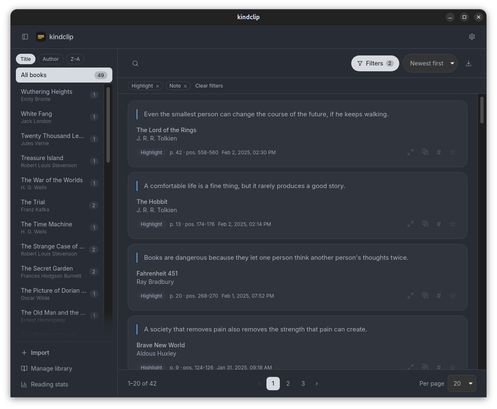
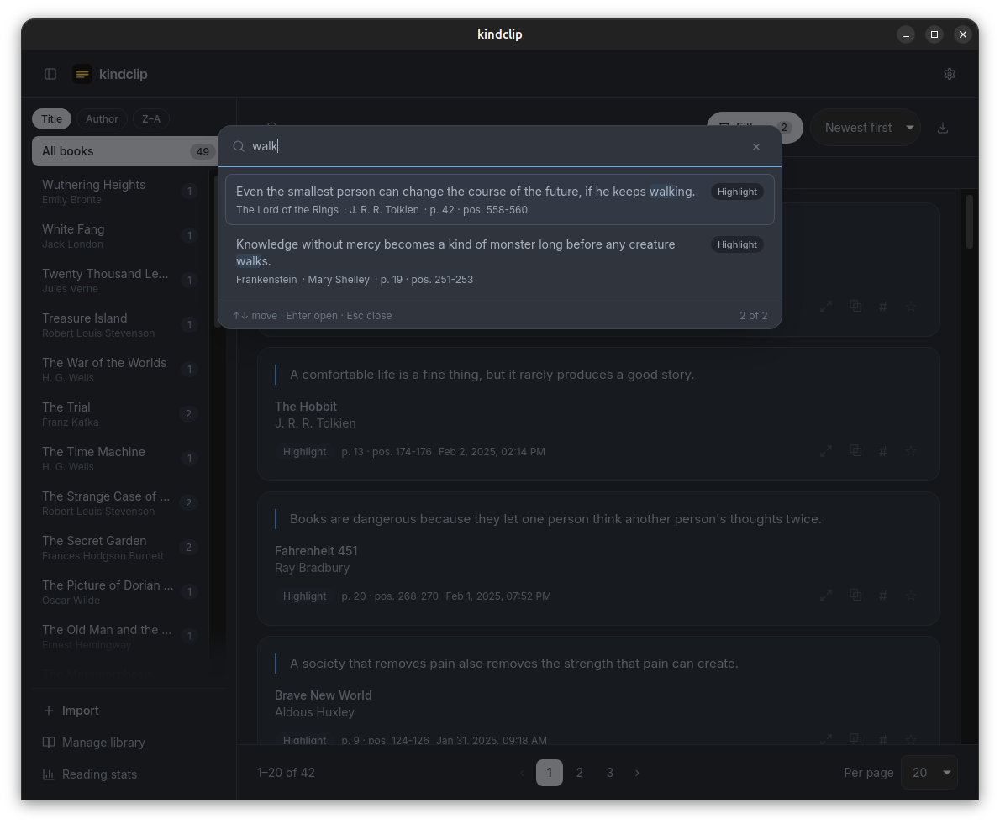

#  kindclip

Desktop viewer for your Kindle highlights. Import `My Clippings.txt`, search
across text, books and authors, filter, star favorites, tag, edit notes, export
to Markdown, JSON or CSV, and track your reading stats. Native look, tiny
binaries, on Windows, Linux and macOS.

**[Landing page](https://damrek.github.io/kindclip/)** · screenshots, palettes
and downloads.


<p>
  
</p>
*Library view in a dark theme: book sidebar, clipping cards with page and date,
and the active filters as removable chips.*

<details>
<summary>Global search (<code>Ctrl/Cmd+P</code>)</summary>

<p>
  
</p>
<p><em>Every clipping in the library, across all books and filters, newest first;
the footer counts the matches, and Enter opens the selected one.</em></p>

</details>

## Usage

1. Install from [Releases](https://github.com/damrek/kindclip/releases/latest):
   `.AppImage`/`.deb`/`.rpm` (Linux), `.exe`/`.msi` (Windows), `.dmg` (macOS).
2. Copy `documents/My Clippings.txt` from your Kindle.
3. **Import** → pick the file, or drag a `.txt` onto the window. Re-import any
   time: duplicates are skipped by content hash, and new highlights are added.
4. Search, filter and read: `?` shows every shortcut and `⤢` opens a clipping
   full-window.
5. Export the current view, or back up the database from **Preferences → Data**.

## Features

### Core
- **Robust parser**: UTF-8/16 (BOM or mid-file), localized dates (en/es/de/fr/it/pt),
  Highlight/Note/Bookmark kinds, including modern Spanish firmware («Tu resaltado»).
- **Multi-file library** with content-hash deduplication across imports.
- **Drag & drop import**: drop a `.txt` anywhere on the window — same parse,
  dedupe and progress report as the Import button.
- **Reading view**: any clipping full-window, ←/→ through the filtered list,
  Esc closes and keeps your place.
- **Note editing**: inline rewrite with an **Edited** badge, reset to the
  original, and an edited-notes filter. `My Clippings.txt` is never modified.

### Library & Organization
- **Favorites** stored in SQLite, with a copy button on every highlight and note.
- **Tags**: free-form per clipping, inline add/remove with suggestions, click a
  tag to filter (AND logic). Rename, merge or delete in **Library → Tags**;
  orphan tags stay listed for cleanup but are hidden from filters.
- **Library management**: filter books by title or author, rename or merge
  books, delete a book with its clippings, and undo one import. Destructive
  actions confirm; re-importing restores the clippings, but not favorites, tags
  or edited notes.
- **Reading stats** (sidebar footer): library-wide totals plus clippings per
  year, kind and top book, with undated clippings grouped as “no date”.

### Search & Filter
- **Unified Filters menu** with a badge, removable chips and **Clear all**.
  Full-text search covers content, title and author, accent- and
  case-insensitive; every word must match and hits are highlighted in the list
  and the reading view. Combine with book, multi-select type/status/tag filters;
  click a card's type or **Edited** badge to toggle it. Pagination 20/50/100.
- **Sorting**: books by title or author (↑/↓); clippings by newest/oldest, book
  title (A–Z/Z–A) or page. All persisted.

### Export & Data
- **Export** the filtered view to Markdown, JSON or CSV as one file grouped by
  book, with favorites and tags marked. Markdown labels follow the app language;
  JSON/CSV keep stable English fields (original and edited notes, tags) for
  scripting.
- **Backup & restore** (Preferences → Data): save a consistent snapshot of
  `kindclip.db` (default `kindclip-backup-YYYY-MM-DD.db`). Restores verify the
  file is real SQLite with the kindclip tables and no failed migrations, preview
  its contents, then keep the replaced database as `kindclip.db.before-restore`.
  Older snapshots migrate on launch; newer ones are refused, and the app
  restarts.
- **Open database location** reveals `kindclip.db` in your file manager.

### UI & Accessibility
- **Collapsible shell**: sidebar toggle (remembered); search collapses to an
  icon until clicked or filled.
- **Grouped chrome**: the top bar keeps only the sidebar toggle and the
  settings gear; search, filters, sort and export sit above the list they act
  on; the sidebar footer carries import, library management and statistics.
- **Preferences dialog**: language, system/light/dark theme with four dark
  palettes — Atom One Dark, Darcula, Nord and Solarized Dark — text size S/M/L,
  DB location, logs folder and shortcuts.
- **WCAG AA palettes**: body, muted, accent and status text clear 4.5:1 on
  every surface they land on, in all five themes; search marks and text
  selection are tuned the same way.
- **Keyboard-first**: `?` opens the shortcut sheet; `/`, `Ctrl/Cmd+K` and
  `Ctrl/Cmd+F` focus search; `Ctrl/Cmd+P` searches every clipping across all
  books and filters; `j`/`k` or ↑/↓ select, `Enter`/`o` opens the reading view,
  `*` favorites, `c` copies, `s`/`f` toggle sidebar and filters, `n`/`p` or
  PageDown/PageUp page, `Ctrl/Cmd+,` opens preferences. `Esc` closes one layer
  at a time and typing fields are never hijacked.
- **5 languages** (es/en/fr/de/it, Spanish default), bundled **Inter** font,
  custom icons, and a minimal macOS-style UI over the native frame.
- **Remembered window**: size, position and maximized state are restored on
  launch, and the window only appears once that state is applied.
- **Diagnostic logs** (Preferences → Diagnostics): rotating local files record
  startup, import, export, backup and restore outcomes — paths, counts, sizes
  and errors only, never clipping text or notes. Nothing is uploaded.

## Development

**Requirements**: Node.js 20+ and a stable Rust toolchain.

**Linux deps** (Ubuntu):
```bash
sudo apt update && sudo apt install -y libwebkit2gtk-4.1-dev build-essential \
  curl wget file libxdo-dev libssl-dev libayatana-appindicator3-dev \
  librsvg2-dev patchelf
```

```bash
npm install
npx tauri dev      # not `npm run dev`: no Tauri IPC bridge
npx tauri build    # bundles land in target/release/bundle
```

**Tests & checks**:
```bash
npm test           # vitest (frontend)
npm run check      # svelte-check
npm run build      # vite build
cargo test --workspace
cargo clippy --workspace --all-targets
cargo fmt --all -- --check
```

Releases run on every `v*` tag push (`.github/workflows/release.yml`): version
sync, checks, tests, then bundles for macOS (ARM + Intel), Linux and Windows.
*macOS/Windows artifacts are unsigned, so Gatekeeper/SmartScreen will warn.*

## Structure

```
src/                        # Svelte 5 + Tailwind v4 frontend
  lib/                      # db, backup, exporter, importer, stats, i18n, theme, types
  components/               # BookSidebar, ClippingCard, FilterMenu, dialogs, ...
  assets/icon.png
src-tauri/
  src/                      # migrations, plugin/command registration, file I/O
  migrations/               # 001 init … 005 search folding
  capabilities/             # least-privilege: sql, dialog, clipboard, opener, log
crates/clippings-parser/    # pure My Clippings.txt parser (no Tauri deps)
```

## Database Location

Resolved to the standard per-OS config dir (`identifier: app.kindclip`):

| OS | Path |
|---|---|
| Linux | `~/.config/app.kindclip/kindclip.db` |
| Windows | `%APPDATA%\app.kindclip\kindclip.db` |
| macOS | `~/Library/Application Support/app.kindclip/kindclip.db` |

Delete the file to wipe the library and note edits, then re-import from scratch.
A restore keeps the replaced file as `kindclip.db.before-restore`, so you can
undo it by hand while the app is closed.

Quick count:
```bash
python3 -c "import sqlite3, os; con=sqlite3.connect(os.path.expanduser('~/.config/app.kindclip/kindclip.db')); print(con.execute('SELECT COUNT(*) FROM clippings').fetchone())"
```

Diagnostic logs live in the standard per-OS log dir — `~/.local/share/app.kindclip/logs`
(Linux), `%LOCALAPPDATA%\app.kindclip\logs` (Windows), `~/Library/Logs/app.kindclip`
(macOS). Installed builds write `kindclip.log` and `tauri dev` writes
`kindclip-dev.log`, rotated at 1 MB over three files. Open the folder from
**Preferences → Diagnostics → Open logs folder**. They hold paths, counts, sizes
and error messages only — never clipping text, notes, search queries, tags or
book titles.

## Roadmap

Planned, no dates attached:

- **Recall**: a random clipping from the current filters, plus “on this day”
  clippings from previous years.
- **Copy as quote**: a Markdown citation with book, author and page.
- **Note ↔ highlight pairing** and **bulk actions** (tag, favorite or export a
  selection).
- **Desktop polish**: signed auto-update.

The layered architecture (parser → commands → SQL → UI) keeps additions local.

## License

MIT — see [LICENSE](LICENSE).
