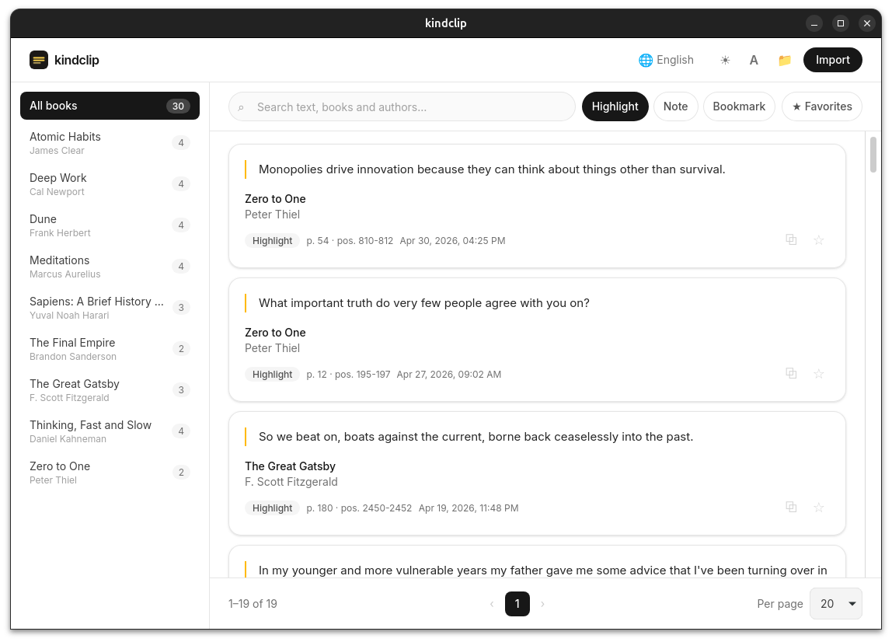
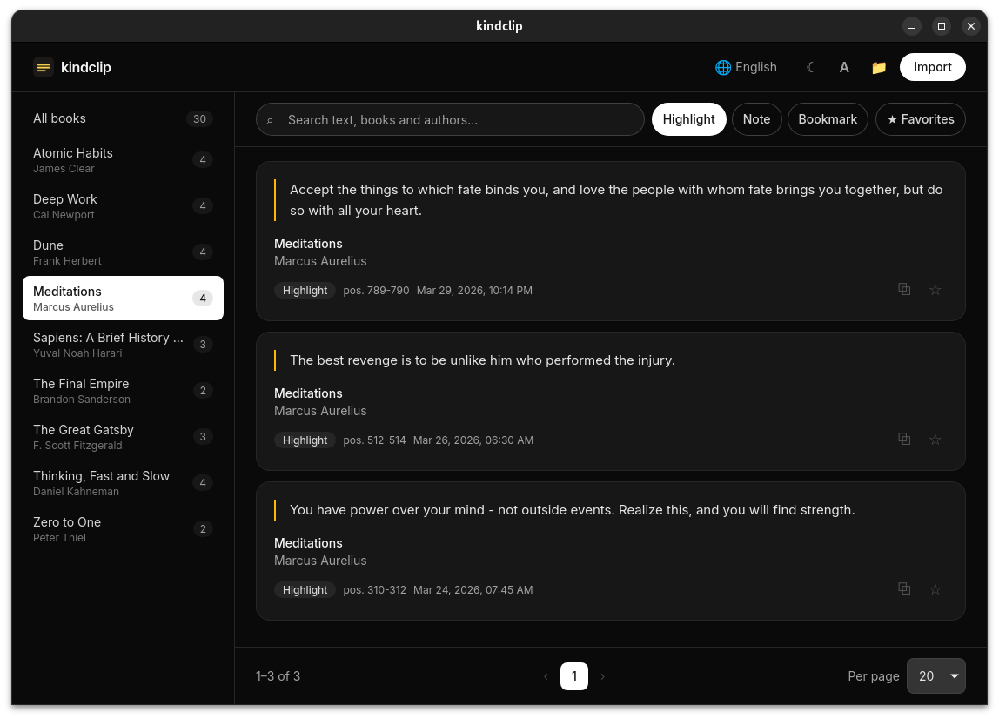

#  kindclip

Desktop viewer for your Kindle highlights. Import `My Clippings.txt`, search
by text, book or author, page through results, star favorites and copy them to
the clipboard. Native look, tiny binaries, on Windows, Linux and macOS.


<p>
  
  
</p>
*Library view: book sidebar, live search, cards and pagination — in light and dark theme.*

## Usage

1. Install the app (`.deb` on Ubuntu, `.AppImage` on other Linux distros;
   Windows/macOS installers via `npx tauri build` on those machines).
2. Plug in your Kindle over USB and grab `documents/My Clippings.txt`.
3. Hit **Import**, pick the file, browse. Re-import any time: duplicates are
   detected by hash, and files that previously failed to parse get healed.

## Features

- **Robust parser**: UTF-8 and UTF-16 (with/without BOM, even mid-file),
  localized dates (en, es, de, fr, it, pt) and Highlight / Note / Bookmark
  kinds — including modern Spanish firmware wording («Tu resaltado»).
- **Multi-file library** with content-hash dedupe across imports.
- **Filters**: full-text search over content, title and author, plus book, kind
  and favorites-only filters. Configurable **pagination** (20/50/100).
- **Favorites** in SQLite and a **copy button** on every highlight and note.
- **UI in 5 languages** (es, en, fr, de, it — Spanish by default) and a
  **system/light/dark theme**, both persisted.
- Bundled **Inter** typeface, custom icons and a minimal macOS-style UI over
  the native window frame.

## Requirements

- Node.js 20+ and a stable Rust toolchain.
- On Linux, the Tauri system dependencies (e.g. Ubuntu):
  ```bash
  sudo apt update && sudo apt install -y libwebkit2gtk-4.1-dev build-essential \
    curl wget file libxdo-dev libssl-dev libayatana-appindicator3-dev \
    librsvg2-dev patchelf
  ```

## Development

```bash
npm install
npx tauri dev      # do NOT use plain `npm run dev`: without the Tauri runtime there is no IPC bridge!
```

## Build

```bash
npx tauri build    # .deb/.rpm/.AppImage on Linux — see target/release/bundle
```

Releases are automated: pushing a `v*` tag (e.g. `v0.2.0`) runs
`.github/workflows/release.yml`, which syncs the version from the tag, checks,
tests and publishes bundles for macOS (ARM + Intel), Linux and Windows.
Note: macOS/Windows artifacts are unsigned — Gatekeeper/SmartScreen will warn
until signing is configured.

## Tests & checks

```bash
npm test                          # vitest (frontend)
npm run check                     # svelte-check
npm run build                     # vite build
cargo test --workspace            # parser + commands
cargo clippy --workspace --all-targets
cargo fmt --all -- --check
```

## Structure

```
src/                        # Svelte 5 + Tailwind v4 frontend
  lib/
    db.ts                   # SQL port (plugin-sql): queries + import orchestration
    importer.ts             # Import flow: pick → parse → persist
    library.ts              # Pagination, debounce, formatting (tested)
    i18n.ts                 # es/en/fr/de/it dictionaries (parity tested)
    theme.ts                # system/light/dark theme
    types.ts                # Shared frontend/backend contracts
  components/               # BookSidebar, ClippingCard, Pagination, ...
  assets/icon.png           # App icon, also shown in the header
src-tauri/
  src/
    lib.rs                  # Migrations + plugin and command registration
    commands.rs             # parse_clippings_file (reads, SHA-256 hashes, parses)
  migrations/001_init.sql   # Schema: files, books, clippings, favorites
  capabilities/             # Least-privilege permissions (sql, dialog, clipboard write)
crates/clippings-parser/    # Pure My Clippings.txt parser (no Tauri deps)
odd/tasks/kindclip.md       # Decision and task log of the project
```

## Where the database lives

The SQL plugin resolves `sqlite:kindclip.db` to the standard per-OS config dir
(derived from `identifier: app.kindclip`):

- Linux: `~/.config/app.kindclip/kindclip.db`
- Windows: `%APPDATA%\app.kindclip\kindclip.db`
- macOS: `~/Library/Application Support/app.kindclip/kindclip.db`

To wipe the library and re-import from scratch, just delete that file.
Quick inspection:
```bash
python3 -c "import sqlite3, os; con=sqlite3.connect(os.path.expanduser('~/.config/app.kindclip/kindclip.db')); print(con.execute('SELECT COUNT(*) FROM clippings').fetchone())"
```

## Roadmap (V2)

Note editing, export (Markdown/JSON/CSV) and cross-machine sync. The current
layering (pure parser → commands → SQL port → UI) allows it without rewriting.

## License

MIT — see [LICENSE](LICENSE).
